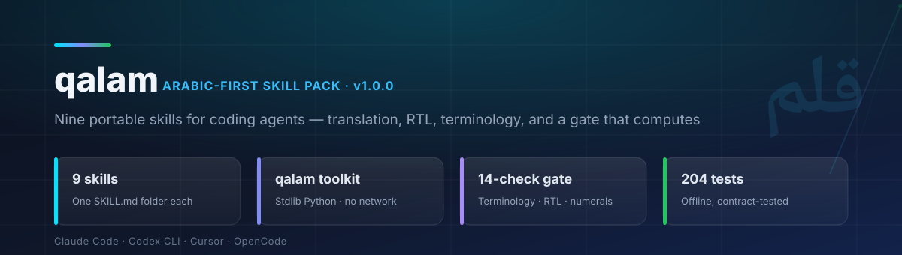

<div align="center">



<br/>

**تسع مهارات (Agent Skills) محمولة، مع مكتبة Python بلا أي اعتمادية خارجية. ترجمة تصمد بعد إعادة التشغيل، وبوابة جودة من ١٥ فحصًا، وصيغ جمع عربية ست، واتجاه RTL لا يعتمد على «تذكُّر» النموذج للحذر.**

[](https://github.com/abduallahJamal/qalam-skills/actions/workflows/ci.yml)
[](pyproject.toml)
[](#جودة-التنفيذ)
[](#المهارات)
[](#جودة-التنفيذ)
[](#بوابة-الجودة)
[](#التثبيت)
[](LICENSE)

**[🇬🇧 English](README.md)** · **🇪🇬 العربية**

</div>

---

## 📌 لماذا قلم؟

كل مشروع ترجمة عربي يتعطّل في الأماكن نفسها: المصطلحات تنزلق من الفصل الرابع، وإعادة التشغيل تعيد ترجمة الكتاب كله لأن لا شيء يسجّل ما تغيّر، وعلامات ترقيم ASCII تتسرّب إلى النص العربي، والواجهة تُقلب في الاتجاه الخطأ. لا يمكن لبرومبت أن يصلح هذا، لأن البرومبت بلا ذاكرة وبلا حساب.

يقسم *قلم* العمل. **النموذج يقرّر ماذا يفعل، والأداة تحسب النتيجة.** كل خطوة يمكن حسابها — التقطيع، مطابقة المصطلحات، نسب الطول، سرعة قراءة الترجمة، صيغة الجمع — تنفّذها مكتبة Python بالـ stdlib فقط. المهارات هي الإجراء، والمكتبة هي الدليل.

| البُعد | مهارة برومبت فقط | خدمة ترجمة سحابية | **`قلم`** |
| :--- | :--- | :--- | :--- |
| **إلى أين يذهب النص** | إلى سياق النموذج | إلى خادم شخص آخر | **يبقى محليًا — بلا أي اتصال شبكي** |
| **المصطلحات** | تُشرح من جديد كل جلسة | محبوسة في لوحتهم | **`glossary.json` في مستودعك، تُحقن لكل مقطع** |
| **إعادة تشغيل مهمة طويلة** | تبدأ من الصفر | تُحاسَب مرة أخرى | **`run_state.json` يتخطى المقاطع غير المتغيرة** |
| **فحص الجودة** | «كن دقيقًا» | درجة من المزوّد | **١٥ فحصًا ميكانيكيًا برمز خروج** |
| **خصوصية العربية** | ما يتذكره النموذج | غالبًا مفتاح لغة | **الاتجاه، `،؛؟`، ست صيغ جمع، حقل الجنس** |
| **الحمولية** | صيغة أداة واحدة | تطبيقهم | **مجلد `SKILL.md` واحد، أربع أدوات، بلا نسخ مختلفة** |

---

## 🧩 المهارات

| المهارة | متى تُستخدم | ما تفعله |
| :--- | :--- | :--- |
| `translate-docs` | ترجمة كتاب أو دليل أو مجلد وثائق | خط أنابيب كامل: تقطيع، مسرد، حالة قابلة للاستئناف، بوابة جودة، معاينة RTL |
| `arabic-style` | تحسين نص عربي أو مراجعة صياغة | تحرير دون تغيير المعنى: السجل، الإيقاع، علامات الترقيم، آثار الترجمة الآلية |
| `rtl-layout` | واجهة عربية تبدو مقلوبة أو مكسورة | خصائص منطقية، bidi، الأيقونات التي تُقلب والتي لا تُقلب، لكل الإطارات |
| `glossary-builder` | اتساق المصطلحات في مشروع طويل | بناء مسرد ثنائي اللغة، تدقيق التعارضات، حقن المصطلحات لكل مقطع |
| `translation-qa` | مراجعة ترجمة قبل النشر | بوابة آلية + قراءة منظمة + تقرير عيوب بأولويات |
| `localize-app` | تعريب واجهة تطبيق | ملفات JSON/resx/po/arb/strings، حماية المتغيّرات، صيغ الجمع الست |
| `extract-docs` | استخراج نص من PDF أو DOCX | تحويل إلى Markdown سليم، ومشاكل العربية في PDF تحديدًا |
| `subtitle-translate` | ترجمة ملفات SRT/VTT | سرعة القراءة، تقسيم الأسطر، التحقق من التوقيت، عرض RTL |
| `skill-forge` | كتابة مهارة جديدة | قوالب، شروط التحميل، أخطاء شائعة، مراجعة مهارات الآخرين |

كل مهارة تبدأ بـ **قاعدة حاكمة** تحدد معنى الإنجاز، ثم إجراءً مرقّمًا، ثم جدول أعطال، ثم عقدًا للتقرير النهائي. لا تقول المهارات «كن دقيقًا»؛ تقول ما يُفحص وكيف.

---

## 🏗 هيكل المستودع

```text
qalam-skills/
├── skills/                 تسع مهارات مستقلة
│   ├── translate-docs/     SKILL.md + references/
│   ├── arabic-style/       ...
│   └── skill-forge/
├── qalam/                  مكتبة Python (stdlib فقط، بلا شبكة)
│   ├── chunk.py            التقطيع + manifest
│   ├── glossary.py         بناء / تدقيق / حقن المسرد
│   ├── runstate.py         بصمات المقاطع والمصطلحات
│   ├── qa.py               بوابة الجودة (١٥ فحصًا)
│   ├── render.py           معاينة HTML باتجاه صحيح
│   ├── install.py          مثبّت link / copy / junction
│   └── cli.py              أمر `qalam`
├── bin/qalam               تشغيل مباشر من المستودع
├── demo/                   مثال شامل يعمل فعليًا
├── examples/               فاحص ملفات التعريب + تطبيق عربي
├── docs/                   أدلة كاملة بالعربية والإنجليزية
├── tests/                  ٢٠٤ اختبارات، كلها بلا شبكة
└── assets/banner.svg       ترويسة المستودع
```

---

## 🚀 التثبيت

```bash
python3 -m qalam install --tools claude codex cursor opencode --dry-run   # معاينة
python3 -m qalam install --tools claude codex cursor opencode            # تنفيذ
```

النمط الافتراضي **رابط** (link)، فتعديل مهارة يعدّل نسختها في كل الأدوات. على Windows يُستخدم junction بلا صلاحيات مسؤول. لو فشل الربط (نظام ملفات لا يدعمه) تُنسخ الملفات تلقائيًا ويُخبرك الأمر بذلك.

| الأداة | على مستوى المستخدم | على مستوى المشروع |
| :--- | :--- | :--- |
| Claude Code | `~/.claude/skills/` | `.claude/skills/` |
| Codex CLI | `~/.codex/skills/` | `.codex/skills/` |
| Cursor | `~/.cursor/skills/` | `.cursor/skills/` |
| OpenCode | `~/.config/opencode/skills/` | `.opencode/skills/` |
| محمول | `~/.agents/skills/` | `.agents/skills/` |

```bash
# للمشروع الحالي فقط
python3 -m qalam install --tools claude cursor --scope project

# مع قاعدة Cursor التي تُرشّد الوكيل إلى المهارة المناسبة
python3 -m qalam install --tools cursor --scope project --cursor-rule

# معرفة ما هو مثبّت وما هو قديم
python3 -m qalam doctor --details

# إزالة
python3 -m qalam uninstall --tools codex --skill translate-docs
```

### تثبيت يدوي

انسخ مجلد المهارة كما هو إلى مسار الأدوات. لا تعديل ولا تحويل: العقد هو أن المجلد نفسه يعمل في كل الأدوات.

```bash
cp -r skills/translate-docs ~/.claude/skills/
cp -r skills/translate-docs ~/.codex/skills/
```

**مهم:** بعد التثبيت أعد تشغيل الأداة أو ابدأ جلسة جديدة. معظم الأدوات تقرأ المهارات عند بدء الجلسة فقط.

| الأداة | كيف تتأكد أن المهارة محمّلة |
| :--- | :--- |
| Claude Code | اكتب `/` وابحث عن اسم المهارة |
| Codex CLI | `$translate-docs` أو قائمة `/skills` |
| Cursor | اطلب المهمة بلغة طبيعية؛ يظهر استخدام المهارة في سجل الوكيل |
| OpenCode | اطلب المهمة؛ أو `@translate-docs` في الإصدار ٢ |

---

## ⚡ الاستخدام

### من داخل الوكيل

اطلب المهمة بلغتك العادية. الوصف (description) هو ما يفعّل المهارة، لذا اذكر الكائن والنية:

- «ترجم هذا الكتاب إلى العربية وحافظ على المصطلحات»
- «راجع هذه الترجمة قبل النشر»
- «الواجهة مقلوبة عندما أبدّل إلى العربية»
- «عرّب ملفات `ar.json`»

أو استدعِها بالاسم: `/translate-docs` في Claude Code، `$translate-docs` في Codex.

### من الطرفية مباشرة

كل ما تفعله المهارة يمكنك فعله بنفسك:

```bash
# تقسيم مستند إلى مقاطع قابلة للترجمة
./bin/qalam chunk docs/manual.md --out-dir work/ar --target-chars 6000

# بناء مسرد مقترح ثم مراجعته يدويًا
./bin/qalam glossary build docs --out work/ar/glossary.json --code
./bin/qalam glossary audit work/ar/glossary.json

# ماذا بقي للترجمة؟
./bin/qalam plan work/ar --glossary work/ar/glossary.json --target-language ar

# بوابة الجودة
./bin/qalam gate --source docs/manual.md --target work/final.ar.md \
  --glossary work/ar/glossary.json

# معاينة HTML باتجاه صحيح وخط عربي
./bin/qalam preview work/final.ar.md --out work/preview.html --target-language ar
```

---

## 🔄 كيف يعمل خط الترجمة

```text
مستند المصدر
   │
   ├─ qalam chunk ──────────► chunk0001.md … + manifest.json
   │
   ├─ qalam glossary build ─► glossary.json  (أنت تملأ الترجمات)
   │
   ├─ qalam plan ───────────► قائمة المقاطع المطلوبة فقط
   │
   ├─ لكل مقطع: ترجمة + qalam gate + qalam record
   │
   ├─ qalam merge ──────────► النص الكامل
   │
   └─ qalam preview ────────► HTML عربي جاهز للقراءة
```

**لماذا ملف حالة؟** لأن ترجمة كتاب تُقطع دائمًا. `run_state.json` يسجّل لكل مقطع بصمة المصدر وبصمة المصطلحات المنطبقة عليه. عند إعادة التشغيل:

- مقطع لم يتغير ← لا يُعاد.
- مقطع تغيّر مصدره ← يُعاد.
- مصطلح تغيّر أو أُضيف له مرادف ← تُعاد **المقاطع التي تحتويه فقط**، لا الكتاب كله.

هذا هو الفرق العملي بين أداة تُستخدم مرة وأداة تُستخدم كل أسبوع.

### بوابة الجودة

تفحص ١٥ نوعًا من العيوب: نسبة الطول، البنية، الأكواد، الروابط، الأرقام، التكرار، الأقواس، النص غير المترجم، نص الرابط، خلط اللغات، ترقيم عربي، العناوين، المسافات، والمصطلحات.

```text
$ qalam gate --source demo/source.en.md --target demo/bad.ar.md --glossary demo/glossary.json
words 177 → 171 (ratio 0.966)
WARN  arabic_punctuation  ASCII ',' after Arabic letters; use '،'
WARN  link_text           link text left in the source language: [the parser notes](…)
errors=0 warnings=2 infos=0 ok=true
```

عيوب حقيقية في ملف حقيقي. أمّا الملف السليم فيخرج بـ `no findings`.

---

## 🇪🇬 دعم العربية

العربية ليست «إنجليزي بخط آخر». الحزمة تعالج:

- **الاتجاه** — `dir` على مستوى الجذر، الخصائص المنطقية (`margin-inline-start` بدل `margin-left`)، عزل النص المختلط (`<bdi>`، U+2066/U+2069).
- **علامات الترقيم** — `،` `؛` `؟`، بلا مسافة قبلها، وأقواس متناظرة.
- **الأرقام** — غربية أو هندية (٠١٢) أو كما في المصدر، مع إبقاء الغربية داخل الأكواد والروابط دائمًا.
- **التشكيل** — لا يُشكّل النص الكامل؛ يُضاف فقط لرفع الالتباس.
- **صيغ الجمع** — ست صيغ في العربية (zero/one/two/few/many/other) في ملفات التعريب، لا صيغتان.
- **المطابقة** — تطبيع الهمزات والألف المقصورة والتطويل قبل المقارنة، وإبقاء الشكل الأصلي في العرض.
- **الجنس** — حقل `gender` في المسرد مؤثر في اتفاق الفعل والصفة، لا زينة.

---

## 🧪 جودة التنفيذ

- **بلا اعتماديات**: مكتبة Python بالـ stdlib فقط، بلا شبكة، بلا تثبيت.
- **٢٠٤ اختبارات**: كل منها يحرس عيبًا وقع فعليًا أثناء التطوير — حذف كلمات عند إعادة لف الأسطر، تسريب محارف العزل داخل وسوم HTML، اعتبار الكود «غير مترجم»، تلوّث ذاكرة الترجمة بعلامات الترقيم.
- **اختبارات عقد للسكيلز**: وصف يحمل كلمات تفعيل، مراجع موجودة فعلًا، أوامر CLI صحيحة، جداول أعطال، وحدود طول.
- **CI** يعمل على Ubuntu و Windows و macOS بإصدارَي Python 3.9 و 3.12، ويتحقق من السكيلز بصرامة، وينفّذ المثال، ويفشل إن استوردت المكتبة أي وحدة شبكية.
- **مثال شامل**: `python3 demo/run_demo.py` ينفّذ الخط كاملًا ويكتب مخرجات حقيقية.

---

## ⚠️ القيود المعروفة

- لا تُنتج الحزمة ترجمة بنفسها. النموذج هو المترجم؛ الحزمة تُنظّم وتتحقق.
- لا تتعامل مع ملفات PDF بلا طبقة نصية دون OCR خارجي.
- لا تتحقق من صحة الترجمة الدلالية كاملةً؛ البوابة ميكانيكية، والمراجعة البشرية تبقى ضرورية.
- المعاينة HTML فقط، لا PDF؛ تحويل HTML إلى PDF يبقى للمتصفح (`Ctrl+P`).

---

## 🤝 المساهمة

المساهمات مرحّب بها — راجع [CONTRIBUTING.md](CONTRIBUTING.md). قبل فتح Pull Request:

```bash
python3 -m unittest discover -s tests -t .     # لازم ينجح
python3 -m qalam skill check skills --strict   # لازم يخرج نظيفًا
python3 demo/run_demo.py                       # لازم ينتج ملفات
```

القواعد التي يتبعها أي وكيل يعدّل هذا المستودع في [AGENTS.md](AGENTS.md).

---

## 📄 الترخيص

MIT — استخدمها وعدّلها وأعد توزيعها بحرية. © 2026 عبد الله جمال.
